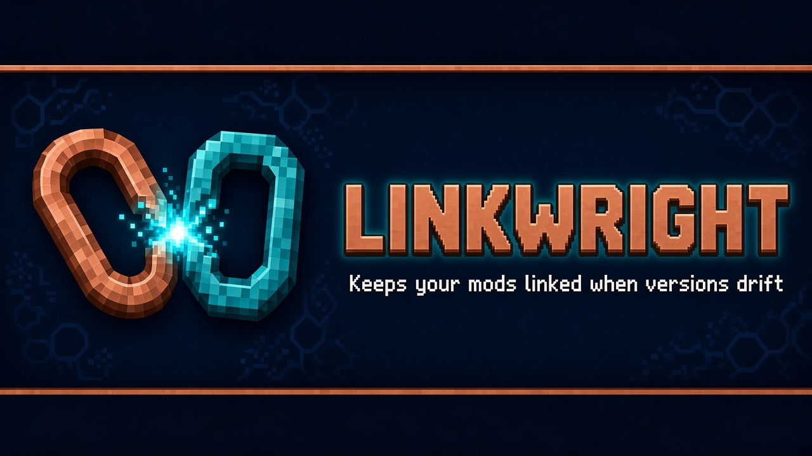

<p align="center">
  
</p>

<p align="center">
  <b>Dependency reducer and link patcher for NeoForge 1.21.1.</b><br>
  Lets your mods load when a version rule is stricter than the code it protects, and patches the small
  changes in between until the authors catch up.
</p>

<p align="center">
  
  
  
  
</p>

---

Mods often pin the exact version range of another mod they integrate with. When that other mod
updates, NeoForge refuses to start ("Mod X requires Y 1.3.0 or above, and below 1.4.0"), even when
the code the first mod actually uses is unchanged, or changed in a way that is trivial to bridge.
Linkwright checks the real code links between the two mods, lets the game launch when they line
up, and patches the small differences in memory as the classes load.

Nothing is written to any mod's jar. The patches exist only while the game runs, so once the
dependent mod updates, Linkwright simply has nothing left to do for it.

## What it does

On every launch, before NeoForge checks dependency versions, Linkwright:

1. Reads every mod's `neoforge.mods.toml` (including mods nested in other jars) and finds the
   mod-to-mod version rules the installed mods break. Rules about Minecraft and NeoForge
   themselves are never touched, and neither are `incompatible` or `discouraged` rules.
2. For each broken rule, walks the dependent mod's bytecode and resolves every class, method and
   field it uses in the dependency, through inheritance into Minecraft and NeoForge. It also
   checks the dependent mod's mixins into the dependency (target classes, injector selectors,
   `@At` targets, shadows, overwrites, accessors and invokers), and that classes extending the
   dependency still implement its abstract methods.
3. When something the dependent mod uses changed shape, looks for exactly one safe way to adapt
   it, and patches the dependent mod's class as it loads (see [Adapters](#adapters)). If more than
   one adaptation fits, or none does, it is left as a problem rather than guessed at.
4. If every link resolves or is adapted, it adds the rule to NeoForge's dependency overrides in
   memory, so the game keeps launching. Otherwise NeoForge's error stays, and the report says
   exactly what is missing.

A full pack of 300+ mods is analyzed in about a second. Everything is written to
`logs/linkwright-report.txt`, including a ready-made `dependencyOverrides` line for packs that
want to ship the approval without Linkwright.

### Examples

**CBC Aeronautics Missiles 0.2.0** pins Create: Radars to `[0.4.9.4, 0.5.0)`. Radars 5 changed
`AutoTargetingHelper.isInSafeZone(Vec3, List)` to `isInSafeZone(Vec3, List, Level)`. Linkwright
verifies the 124 other links, then adapts both calls: one passes the `ServerLevel` the calling
method already has, the other passes `NetworkView.controllerLevel()`.

**Power Grid 0.6.2** pins TFMG to `[1.3.0, 1.4.0)`, and TFMG 1.2.0 stores block positions as packed
`long`s where 1.3 uses `BlockPos`. Linkwright converts the `BlockPos` Power Grid passes to
`new ElectricBlockValues(...)` with `asLong()`, and gives Power Grid's connector the
`long getPos()` that TFMG 1.2's `IElectric` interface requires, by delegating to its
`BlockPos getPos()`.

From the report:

```
powergrid 0.6.2  ->  tfmg 1.2.0
  Rule:     powergrid asks for tfmg [1.3.0,1.4.0), installed is 1.2.0
  Decision: approved: every link checks out
  Checked:  15 links
  Adapted:  2 change(s)
    - ...TFMGCompatDeviceConnectorBlockEntity.<init>: calls ...ElectricBlockValues.<init>(BlockPos) as (J)V (argument 1 via BlockPos.asLong())
    - ...TFMGCompatDeviceConnectorBlockEntity: adds getPos()J for ...IElectric, delegating to getPos()BlockPos (result via BlockPos.asLong())
  Problems: none
```

## Adapters

| Change in the dependency | What Linkwright does |
| --- | --- |
| A method or constructor gained parameters, anywhere in the list | Keeps the old arguments in order and fills each new object parameter from the calling method: one of its parameters, or one public getter on a parameter |
| A parameter, return or field type changed | Converts the value at the call site, if the conversion is lossless (below) |
| A method now returns something where it returned `void` | Discards the result |
| An interface or abstract class requires a method with different types | Adds that method to the dependent mod's class, delegating to its existing method of the same name |

Lossless conversions: subtype to supertype, primitive widening (`int` to `long`, `float` to
`double` and so on), boxing and unboxing, `BlockPos` and `long`, `ChunkPos` and `long`,
`ResourceLocation` and `String`, and `Vec3i` to `BlockPos`.

## What it will not do

- **Override intentional incompatibilities.** If a mod deliberately refuses to load next to
  another (an `incompatible` rule, or a check in its own code), that is the author's decision and
  Linkwright leaves it alone.
- **Guess.** Narrowing conversions (`long` to `int`, supertype to subtype) are never made, added
  `int`, `float` and other primitive parameters are never filled in, and a change with more than
  one possible adaptation is reported instead of patched.
- **Check behaviour.** A method that keeps its signature but changes what it does still passes.
- **Follow renames.** Removed methods with no same-named replacement, and renamed classes, cannot
  be adapted.

Links that lead into libraries Linkwright cannot see (for example DataFixerUpper or fastutil) are
assumed present and counted separately in the report. Calls made from mixin classes, or through
method handles, can be verified but not adapted.

## Installing

Drop the jar into `mods/` on the client, the server, or both. Linkwright runs as a ModLauncher
service, so it does not appear in the in-game mod list and never has to match between client and
server. Each side checks its own mods.

Remember that client and server still need matching versions of the mods themselves to connect.
Linkwright fixes version rules between mods, not differences between your client and a server.

## Configuration

`config/linkwright.toml` is created on first launch:

| Key | Default | Meaning |
| --- | --- | --- |
| `mode` | `"auto"` | `auto` approves verified rules and applies adapters; `report` only writes the report; `off` does nothing |
| `bridgeCalls` | `true` | Apply adapters. When `false`, any changed link is a problem |
| `ignore` | `[]` | Rules to leave alone, as `"dependent->dependency"` |
| `forceApprove` | `[]` | Rules to approve even when problems are found. This can crash the game |

## Building

Requires JDK 21.

```
./gradlew build
```

The jar is `build/libs/linkwright-1.21.1-neoforge-<version>.jar`. To dry-run the analysis
against an existing instance without changing it:

```
./gradlew test --tests com.linkwright.PackScanTest -Plinkwright.testGameDir=<instance folder>
```

## License

[MIT](LICENSE)
