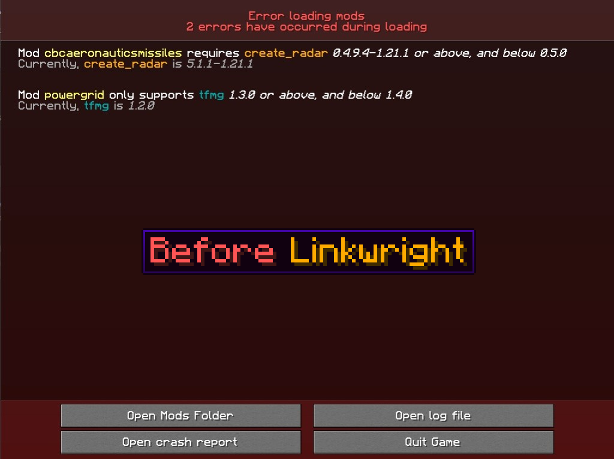
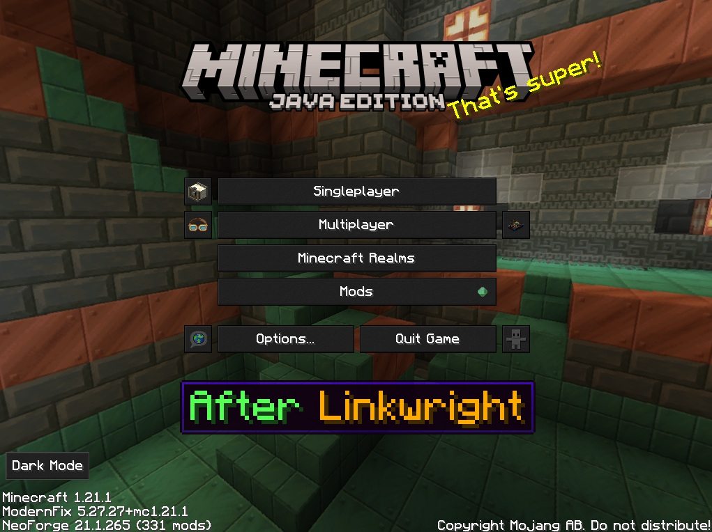

<p align="center">
  
</p>

<p align="center">
  <b>Dependency reducer and link patcher for Forge, NeoForge and Fabric.</b><br>
  Lets your mods load when a version rule is stricter than the code it protects, and patches the small
  changes in between until the authors catch up.
</p>

<p align="center">
  <a href="https://www.curseforge.com/minecraft/mc-mods/linkwright"></a>
  
  
  
  
</p>

---

Mods often pin the exact version range of another mod they integrate with, or of the loader
itself. When that other mod or the loader updates, the game refuses to start ("Mod X requires Y
1.3.0 or above, and below 1.4.0"), even when the code the first mod actually uses is unchanged, or
changed in a way that is trivial to bridge. Linkwright checks the real code links between the two,
lets the game launch when they line up, and patches the small differences in memory as the classes
load.

Nothing is written to any mod's jar. The patches exist only while the game runs, so once the
dependent mod updates, Linkwright simply has nothing left to do for it.

<p align="center">
  
  
</p>

## Download

Get it from [CurseForge](https://www.curseforge.com/minecraft/mc-mods/linkwright) or the
[releases page](https://github.com/pablo67340/Linkwright/releases/latest). Pick the jar for your
loader:

| Loader | File |
| --- | --- |
| Forge 1.17.1 and newer, or any NeoForge | `linkwright-<version>.jar` |
| Forge 1.13.2 to 1.16.5 | `linkwright-1.13-1.16.5-<version>.jar` |
| Forge 1.7.10 to 1.12.2 | `linkwright-1.7.10-1.12.2-<version>.jar` |
| Fabric Loader 0.14 or newer, Minecraft 1.14 to 26.x | `linkwright-fabric-<version>.jar` |

Quilt is not supported yet.

## What it does

On every launch, before the loader checks dependency versions, Linkwright:

1. Reads every mod's metadata (`mods.toml`, `neoforge.mods.toml`, `fabric.mod.json`, or `@Mod`
   on Forge 1.12.2 and older, including mods nested in other jars) and finds the version rules
   the installed mods break: on each other, and on a loader newer than they allow
   (see [Loader version rules](#loader-version-rules)). Rules about Minecraft itself are never
   touched, and neither are `incompatible` or `discouraged` rules.
2. For each broken rule, walks the dependent mod's bytecode and resolves every class, method and
   field it uses in the dependency, through inheritance into Minecraft and the loader. It also
   checks the dependent mod's mixins into the dependency (target classes, injector selectors,
   `@At` targets, shadows, overwrites, accessors and invokers), that classes extending the
   dependency still implement its abstract methods, and that every member is still accessible
   and still static (or not) the way the dependent mod calls it.
3. When something the dependent mod uses changed shape, looks for exactly one safe way to adapt
   it, and patches the dependent mod's class as it loads (see [Adapters](#adapters)). If more than
   one adaptation fits, or none does, it is left as a problem rather than guessed at.
4. Patches every adapted class in memory and verifies the result before approving anything (see
   [Verification](#verification)).
5. If every link resolves or is adapted, it relaxes that one rule in the loader's memory, so the
   game keeps launching. Otherwise the loader's error stays, and the report says exactly what is
   missing.

A full pack of 300+ mods is analyzed in about a second. Everything is written to
`logs/linkwright-report.txt`. On NeoForge the report also includes a ready-made
`dependencyOverrides` line for packs that want to ship the approval without Linkwright.

### Examples

**CBC Aeronautics Missiles 0.2.0** pins Create: Radars to `[0.4.9.4, 0.5.0)`. Radars 5 changed
`AutoTargetingHelper.isInSafeZone(Vec3, List)` to `isInSafeZone(Vec3, List, Level)`. Linkwright
verifies the 124 other links, then adapts both calls: one passes the `ServerLevel` the calling
method already has, the other passes `NetworkView.controllerLevel()`.

**Power Grid 0.6.2** pins TFMG to `[1.3.0, 1.4.0)`, and TFMG 1.2.0 stores block positions as packed
`long`s where 1.3 uses `BlockPos`. Linkwright converts the `BlockPos` Power Grid passes to
`new ElectricBlockValues(...)` with `asLong()`, and gives Power Grid's connector the
`long getPos()` that TFMG 1.2's `IElectric` interface requires, by delegating to its
`BlockPos getPos()`.

From the report:

```
powergrid 0.6.2  ->  tfmg 1.2.0
  Rule:     powergrid asks for tfmg [1.3.0,1.4.0), installed is 1.2.0
  Decision: approved: every link checks out
  Checked:  15 links
  Adapted:  2 change(s)
    - ...TFMGCompatDeviceConnectorBlockEntity.<init>: calls ...ElectricBlockValues.<init>(BlockPos) as (J)V (argument 1 via BlockPos.asLong())
    - ...TFMGCompatDeviceConnectorBlockEntity: adds getPos()J for ...IElectric, delegating to getPos()BlockPos (result via BlockPos.asLong())
  Problems: none
```

### Loader version rules

Some mods pin the loader itself, often by accident: `versionRange="[21.1.243]"` on `neoforge`
accepts exactly one NeoForge build, so the mod refuses every newer one. When the installed
NeoForge, Forge or Fabric Loader is newer than such a rule allows, Linkwright treats the loader
like any other dependency. It checks every class, method, field and mixin target the mod uses in
the loader's own jar, and approves the rule only when all of them still resolve.

A mod that needs a newer loader than the one installed is left alone, since updating the loader
is the fix.

### Duplicate mods

When the same mod is in the mods folder more than once, usually an old version left behind by an
update, Linkwright keeps the copy that was added to the folder last and disables the others by
renaming them to `.jar.disabled`. Going by when each file arrived, not by version number, means a
deliberate downgrade wins over the newer version it replaces. Launchers such as Prism and the
CurseForge app show a `.jar.disabled` file as a disabled mod, so it can be switched back on.

This happens before the loader reads the mods folder, so the game starts normally on the same
launch. Only a file's creation time records when it arrived (the modified time is often copied
from the download), so both copies stay, with a warning saying why, when:

- the file system does not record creation times, as on many Linux servers;
- the copies arrived within a minute of each other, such as in one pack install;
- the older copy also contains a mod the newer one does not;
- the older copy is a jar the loader loads before Linkwright runs, or is in use.

On NeoForge 21.9 and newer the loader has opened every jar before Linkwright runs, so Linkwright
only warns there. NeoForge itself then loads the copy with the highest version.

### Warnings

One problem Linkwright cannot fix, but points out in the log and at the top of the report: a jar
built for a newer Java than the game runs on, which would otherwise crash with an
`UnsupportedClassVersionError` once it loads.

## Adapters

| Change in the dependency | What Linkwright does |
| --- | --- |
| A method or constructor gained parameters, anywhere in the list | Keeps the old arguments in order and fills each new object parameter from the calling method: one of its parameters, or one public getter on a parameter |
| A parameter, return or field type changed | Converts the value at the call site, if the conversion is lossless (below) |
| A method now returns something where it returned `void` | Discards the result |
| An interface or abstract class requires a method with different types | Adds that method to the dependent mod's class, delegating to its existing method of the same name |
| A value is now wrapped in a `Supplier`, `Optional` or Minecraft `Holder` | Unwraps it where it is used (`get()`, `orElse(null)` or the holder's value), only when the generic types prove the wrapped value is the old type |
| A public field was replaced by a getter or setter, or the other way around | Reads through the getter (`getX()`, `isX()` or `x()`) and writes through the setter, or uses the field directly |
| A getter was renamed record-style, such as `getName()` to `name()`, or back | Calls the new name, and renames the dependent mod's own implementations that the dependency calls |
| A method or constructor lost parameters | Drops the arguments that are no longer needed, when only one choice of which ones fits |
| A class moved to another package in the same mod | Points every reference at the new package, unless a mixin, a string or a resource file mentions the old name |
| A method became static, or stopped being static | Drops the unused receiver, passes the first argument as the receiver or the receiver as the first argument, or calls the class's single shared instance |
| A class became an interface, or the other way around | Switches the call instruction to match |

Lossless conversions: subtype to supertype, primitive widening (`int` to `long`, `float` to
`double` and so on), boxing and unboxing, `BlockPos` and `long`, `ChunkPos` and `long`,
`ResourceLocation` and `String`, and `Vec3i` to `BlockPos`.

## Verification

An adapter is only used once it has been proven safe. Before a rule is approved, Linkwright
patches each affected class in memory, without loading it, and runs it through ASM's bytecode
verifier with the types taken from the installed mods. Every method that verified before must
still verify, and every stack map frame must still match. The patched class is then link checked
again from scratch. If any of this fails, the rule is refused and the report says which class
failed and why.

On a game whose ASM has no bytecode verifier, rules that need adapters are refused, while rules
that need none are still approved. The Forge 1.13 to 1.16.5 jar carries ASM's analysis package
for this reason, since Forge 1.13.2 and 1.14.4 do not put it on the classpath.

## What it will not do

- **Override intentional incompatibilities.** If a mod deliberately refuses to load next to
  another (an `incompatible` rule, or a check in its own code), that is the author's decision and
  Linkwright leaves it alone.
- **Guess.** Narrowing conversions (`long` to `int`, supertype to subtype) are never made, added
  `int`, `float` and other primitive parameters are never filled in, and a change with more than
  one possible adaptation is reported instead of patched.
- **Check behaviour.** A method that keeps its signature but changes what it does still passes.
- **Follow arbitrary renames.** Apart from the getter styles above, a removed method with no
  same-named replacement cannot be adapted. A moved class is followed only when it keeps its
  name, and only inside the dependency's own package tree.

Links that lead into libraries Linkwright cannot see (for example DataFixerUpper or fastutil) are
assumed present and counted separately in the report. Calls made from mixin classes, or through
method handles, can be verified but not adapted.

## Installing

Drop the jar for your loader into `mods/` on the client, the server, or both. It never has to
match between client and server, since each side checks its own mods. Linkwright starts before
other mods, so on some versions it does not appear in the in-game mod list.

### Fabric: one extra step

Fabric checks mod versions before any mod gets to run, so Linkwright has to start a little
earlier, as a Java agent. Add this JVM argument once:

```
-javaagent:mods/linkwright-fabric-<version>.jar
```

- **Prism Launcher or MultiMC:** Edit Instance, Settings, Java tab. Tick "JVM arguments" and add it.
- **Minecraft Launcher:** Installations, Edit, More Options. Add it to the start of JVM Arguments.
- **Servers:** add it before `-jar`, for example
  `java -javaagent:mods/linkwright-fabric-1.2.0.jar -Xmx4G -jar fabric-server-launch.jar nogui`.

If the relative path does not work, use the full path to the jar. Without the argument, the log
says "Linkwright is installed but not active" along with the exact argument to add.

### Client and server

Remember that client and server still need matching versions of the mods themselves to connect.
Linkwright fixes version rules between mods, not differences between your client and a server.

## Configuration

`config/linkwright.toml` is created on first launch:

| Key | Default | Meaning |
| --- | --- | --- |
| `mode` | `"auto"` | `auto` approves verified rules and applies adapters; `report` only writes the report; `off` does nothing |
| `bridgeCalls` | `true` | Apply adapters. When `false`, any changed link is a problem |
| `ignore` | `[]` | Rules to leave alone, as `"dependent->dependency"`, such as `"somemod->create"` or `"othermod->neoforge"` |
| `disableDuplicates` | `true` | Disable older copies of a mod that is in the mods folder more than once (see [Duplicate mods](#duplicate-mods)) |
| `forceApprove` | `[]` | Rules to approve even when problems are found. This can crash the game |

## Building

Gradle downloads the JDKs it needs (17 and 21) through toolchains. Linkwright never compiles
against Minecraft, so there is no ForgeGradle, Loom or ModDevGradle setup.

```
./gradlew release
```

This builds every port and collects the four jars in `build/libs`. The shared core lives in
`common/`, loader hooks in `platform/<loader>/`, and each shipped jar is a project under `ports/`.

To dry-run the analysis against an existing instance without changing it:

```
./gradlew test --tests com.linkwright.PackScanTest -Plinkwright.testGameDir=<instance folder>
```

## License

[MIT](LICENSE)
